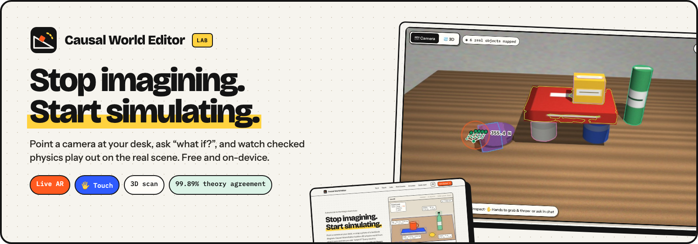
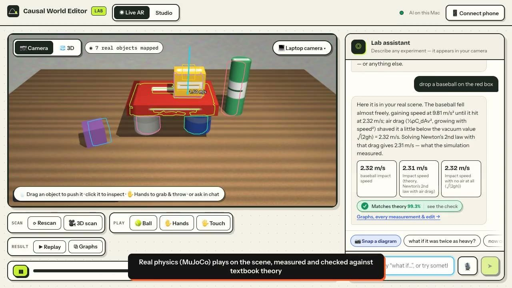
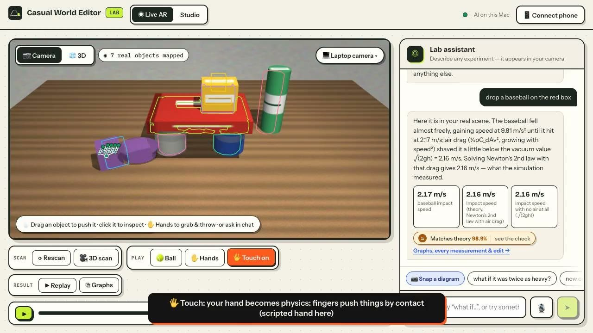
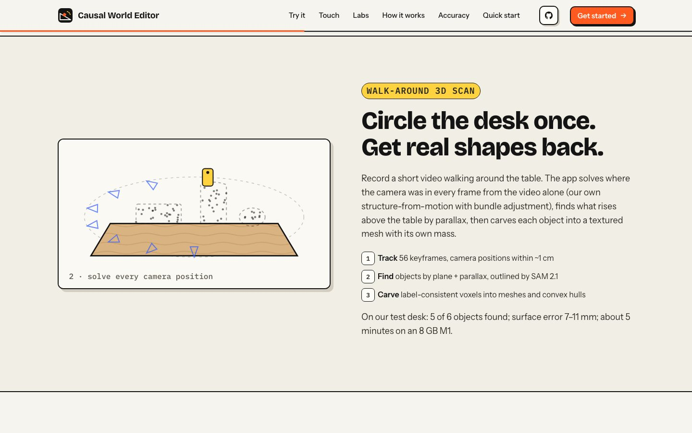
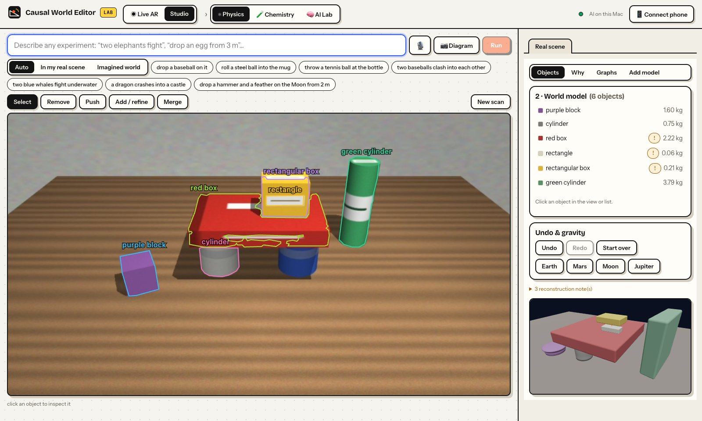
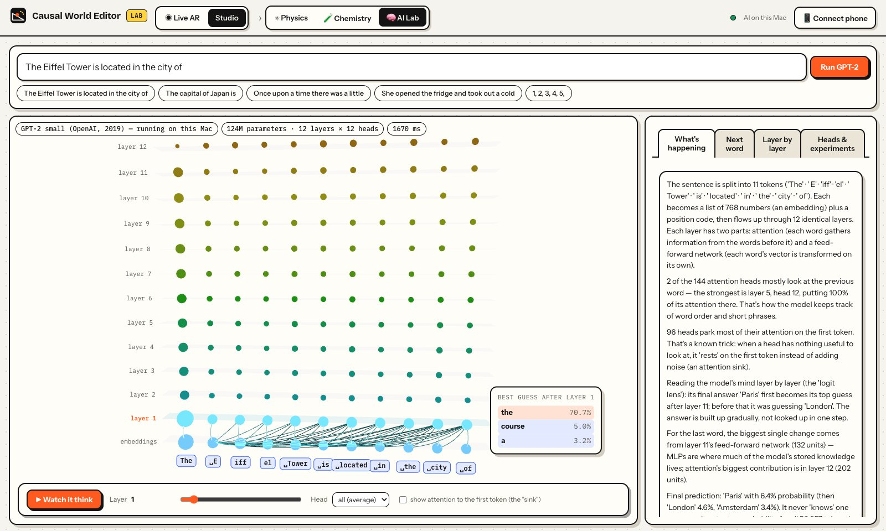
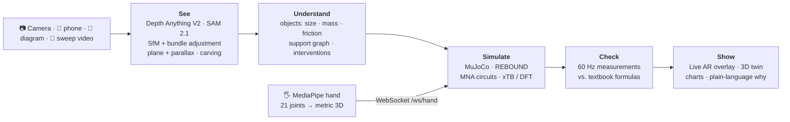

<div align="center">

<a href="https://causalworld.pages.dev"></a>

<br>

**Your desk becomes a physics world. Ask “what if?”, push things with your real hand, and check every answer against textbook theory.**

[](https://causalworld.pages.dev)
[](LICENSE)
[](#-accuracy-you-can-check)
[](#-private-by-design)


[**Try it**](https://causalworld.pages.dev) · [Features](#-what-it-does) · [How it works](#-how-it-works) · [Accuracy](#-accuracy-you-can-check) · [Quick start](#-quick-start) · [Roadmap](#-roadmap)

</div>

---

## The problem

Textbooks show the first frame. A block on a ramp, two balls about to collide, a planet's orbit: students stare at a
still picture and try to play the movie in their heads. Cognitive scientists call this **mental animation**, and it is
hard, even for people who know the formulas. Labs that let you *try* things cost equipment most schools don't have.

**Causal World Editor plays the movie.** Point a camera at your desk, or snap a photo of a diagram. It builds a 3D physics
world from what it sees, lets you change anything, and shows the measured result next to the textbook prediction, so you
get an answer you can verify, not a guess.

<p align="center"></p>

## ✨ What it does

<table>
<tr>
<td width="50%" valign="top">

### 📷 Live AR
Scan your desk with the laptop webcam or your phone. Every object gets **size, mass, friction and what it rests on**.
Click anything to inspect it, drag it to push it, or ask in plain words: *“drop a baseball on the book”*,
*“what if the table were icy?”*, *“moon gravity”*.

</td>
<td width="50%" valign="top">

### 🖐 Touch: your hand is the physics
Hold your hand up to the camera and push the digital twin with your **real fingers**. 21 tracked bones become physics
capsules: you push, tip and flick things by contact, with **live forces in newtons**. When your hand leaves, the session
is replayed exactly (**0.00 mm** drift) and can be measured or undone.

</td>
</tr>
<tr>
<td valign="top"></td>
<td valign="top"></td>
</tr>
<tr>
<td valign="top">

### 🎥 Walk-around 3D scan
Record a short video circling the table. Our own **structure-from-motion** solves where the camera was in every frame,
**plane + parallax** finds what rises above the table, and **label-consistent carving** turns each object into a
textured mesh with its own mass.

</td>
<td valign="top">

### 📐 Snap a diagram
Photograph a textbook page or whiteboard. A local vision model reads it into an **editable reading card**
(*“inclined plane, 30°, 2 kg block…”*); fix anything, press **Simulate this**, then ask *“what if the angle was 60°?”*

</td>
</tr>
</table>

### 🧪 Studio: every lab in one place

<p align="center"> </p>

| Lab | Ask things like | Under the hood |
|---|---|---|
| ⚛ **Physics** | *“two blue whales collide at 10 m/s”*, *“line up 10 dominoes and knock them over”* | MuJoCo at real-world scale; toys scale properly (mass ∝ k³, speed ∝ √k) |
| 🪐 **Space** | *“what if Jupiter orbited Earth?”*, *“Milky Way and Andromeda collide”* | REBOUND IAS15 from NASA JPL Horizons positions; tidal disruption, GW inspiral, mergers |
| 🔌 **Circuits** | *“RC circuit with 100 µF and 1 kΩ”* | Modified nodal analysis (what SPICE uses), with transients |
| 🧪 **Chemistry** | *“burn methane”* | Exact balancing, measured enthalpies, GFN2-xTB dynamics, DFT (M06-2X/def2-TZVP) |
| 🧠 **AI Lab** | *“the cat sat on the”* | A real GPT-2 on your machine: attention heads and the logit lens, layer by layer |

## ⚙ How it works



| Stage | What we built |
|---|---|
| **Depth & outlines** | Depth Anything V2 (metric), SAM 2.1-tiny prompted from geometry instead of “segment everything” (fits in 8 GB) |
| **Walk-around scan** | SIFT tracks → PnP → our own Schur-complement Levenberg–Marquardt bundle adjustment; per-frame depth alignment; label-consistent space carving with depth free-space votes; marching cubes, texture atlas, CoACD convex hulls |
| **Physics** | MuJoCo with calibrated contacts; checkpoints so each action continues from the last settled state (0.4–1.3 s) |
| **Live hand** | MediaPipe world landmarks + a linear solve for metric 3D, One Euro smoothing, mocap bone capsules interpolated every 2 ms step, camera-timestamped WebSocket for exact replay |
| **Language** | Qwen2.5-VL-3B (4-bit, MLX) for labels and diagrams, Whisper for voice; deterministic command parser for scene actions |
| **App** | FastAPI backend · React + React Three Fiber · plain-HTML landing page · phone camera over HTTPS |

## 📊 Accuracy you can check

| What | Result |
|---|---|
| Theory-check agreement (19-experiment battery) | **mean 99.89 %**, worst 99.55 % |
| Automated tests (physics, perception, space, chemistry, hands) | **151 passing** + 1 expected failure |
| DFT reaction energies vs. measured (10 reactions) | **21.6 kJ/mol** mean absolute error, reported as ± max(21.6, 4.5 % of \|ΔH\|) |
| Camera positions solved from video alone (60-frame sweep) | **median 0.9 cm**, worst 2.5 cm |
| Walk-around scan, end to end (photoreal test desk) | surface error **7–11 mm** on found objects; box volume 1458 vs. 1477 cm³; 5 of 6 objects found |
| Live hand physics | **2.2 ms** per update (budget 33 ms); replay matches live to **0.00 mm** |
| Hand tracking | ~**13 ms** per frame on the M1 GPU |
| One-photo scan · walk-around scan | ~3–4 s warm · ~5 min (56 keyframes, M1 8 GB) |

The tests check **physics, not just code paths**: a resting contact force must equal the object's weight, energy given
to a passive object must equal the energy the other one gave up, and a replay must match its live run. When a textbook
formula doesn't apply (e.g. a tidal disruption with a small mass ratio), the result is marked **not scored** instead of
printing a misleading number.

## 🔒 Private by design

Everything runs on the laptop, **free, with no API keys**. Camera frames, voice and diagrams never leave the machine; the
phone talks to the laptop over your local network on HTTPS with a certificate generated on first run. Optional cloud
features exist but are off by default (`ANTHROPIC_API_KEY` for more fluent explanations, `FAL_KEY` to generate missing
3D models; only text is sent).

## 🚀 Quick start

> Requires macOS on Apple Silicon, Python 3.12 and Node 18+. Built and tested on an M1 MacBook with 8 GB.

```bash
git clone https://github.com/iUtsa/causal-world-editor.git && cd causal-world-editor

./setup.sh                                   # Python env, ~250 MB of vision models, UI build
.venv/bin/pip install rebound reboundx pyscf rdkit tblite sympy scipy sentence-transformers qrcode trimesh pillow

python3.12 -m venv .venv-ai && .venv-ai/bin/pip install mlx-vlm   # local vision-language model (Apple GPU)

./restart.sh                                 # starts the server and waits for the models
```

Open **<http://localhost:8000>** for the landing page and press **Get started** (the lab lives at `/lab/`).
Use your phone as the camera: **Connect phone** in the lab, scan the QR code. Hot-reload development: `./dev.sh`.

### 🌍 Share it publicly from your Mac

```bash
deploy/go_public.sh
```

Serves the landing page from Cloudflare Pages (always up) and the lab, API, live hand and phone camera from your Mac
through a free Cloudflare tunnel, at one HTTPS address. Visitors' phones work from any network, no certificate warning.
Our instance: **[causalworld.pages.dev](https://causalworld.pages.dev)** (the lab is live while the team's laptop is
serving; otherwise it says so).

## 🧭 Known limitations

- **One shared lab:** the hosted demo runs on one laptop, so visitors share one scene at a time.
- **Camera stays put after a scan:** no relocalization yet; the phone notices movement and asks for a rescan.
- **Walk-around scan numbers come from a photoreal test desk** with known answers; real-phone sweeps are next. On that
  desk it missed a small ball and carved away a thin clock.
- **🖐 Touch pushes, it doesn't grip yet**, and hand size is estimated from MediaPipe's model.
- **Monocular scale can drift;** calibrate with one object's real height or use RGB-D input.
- **Small local models can misread** messy handwriting, which is why the diagram reading is editable.
- **8 GB is tight:** close other heavy apps before a demo.

## 🗺 Roadmap

- [x] Live AR scan, interventions, theory checks
- [x] Studio: physics, space, circuits, chemistry, AI Lab
- [x] Walk-around 3D scan (SfM + carving) and scanned meshes in physics
- [x] 🖐 Touch: live hand physics with exact replay
- [x] Landing page and a public demo from the laptop
- [ ] Relocalize the camera against the 3D scan so it can move after scanning
- [ ] Grip assist for 🖐 Touch and per-user hand calibration
- [ ] Per-visitor sessions for the hosted demo
- [ ] Teacher-made “what if” lesson packs; classroom pilots

## 🗂 Project layout

```
backend/app/
  main.py               FastAPI app: /api routes, /ws/hand, static UI
  perception/           depth, segmentation, lifting, sweep scan (sfm, discover, track, carve)
  physics/              MuJoCo scenes, interventions, checkpoints, live hand (hand.py)
  scene_cmd.py          plain-language actions on the scanned scene
  experiment.py, lab.py studio experiments and “what if” follow-ups
  orbits.py, galaxy.py  space · circuits.py · chem.py, thermo_dft.py · transformer_lab.py
  remote.py, live.py    phone camera
backend/tests/          unit tests, accuracy report, benches, Playwright end-to-end tests
frontend/
  index.html            landing page (public/landing: styles, interactions, Touch toy)
  lab/index.html        the lab (React app in src/)
deploy/                 Cloudflare Pages site + tunnel script for the public demo
assets/                 CC0 3D object library (licence per asset)
```

## 🙏 Credits

- **Models:** Depth Anything V2, SAM 2.1, Qwen2.5-VL, Whisper, GPT-2, MediaPipe Hand Landmarker
- **Physics & chemistry:** MuJoCo, REBOUND, PySCF, tblite (GFN2-xTB), RDKit, CoACD · **Ephemerides:** NASA JPL Horizons
- **3D models:** [Poly Haven](https://polyhaven.com) (CC0) and Khronos glTF samples; source and licence per asset in
  `assets/library/<id>/LICENSE.json`
- Built at **HackPrinceton**.

## 📄 License

[Apache License 2.0](LICENSE). Third-party models and assets keep their own licences.

<div align="center"><br><sub><b>Causal World Editor</b> · stop imagining, start simulating · <a href="https://causalworld.pages.dev">causalworld.pages.dev</a></sub></div>
