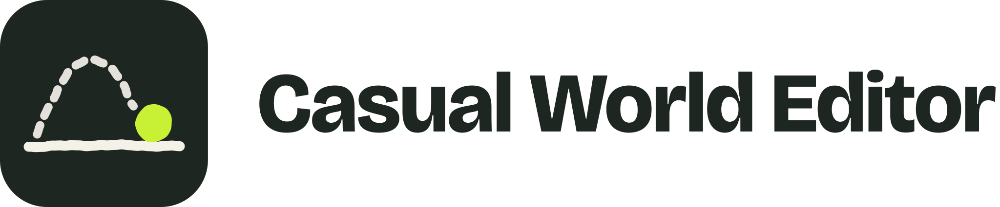
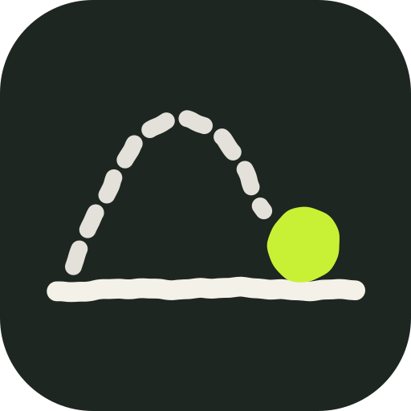
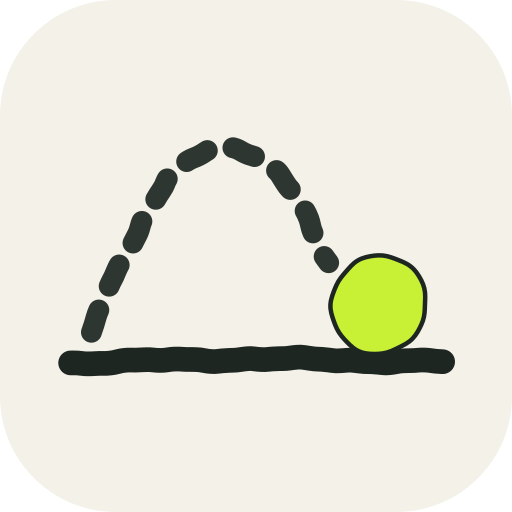
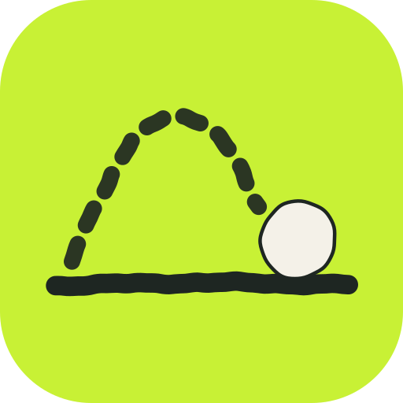
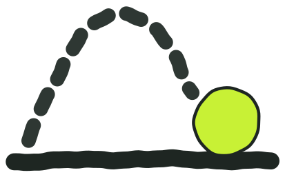
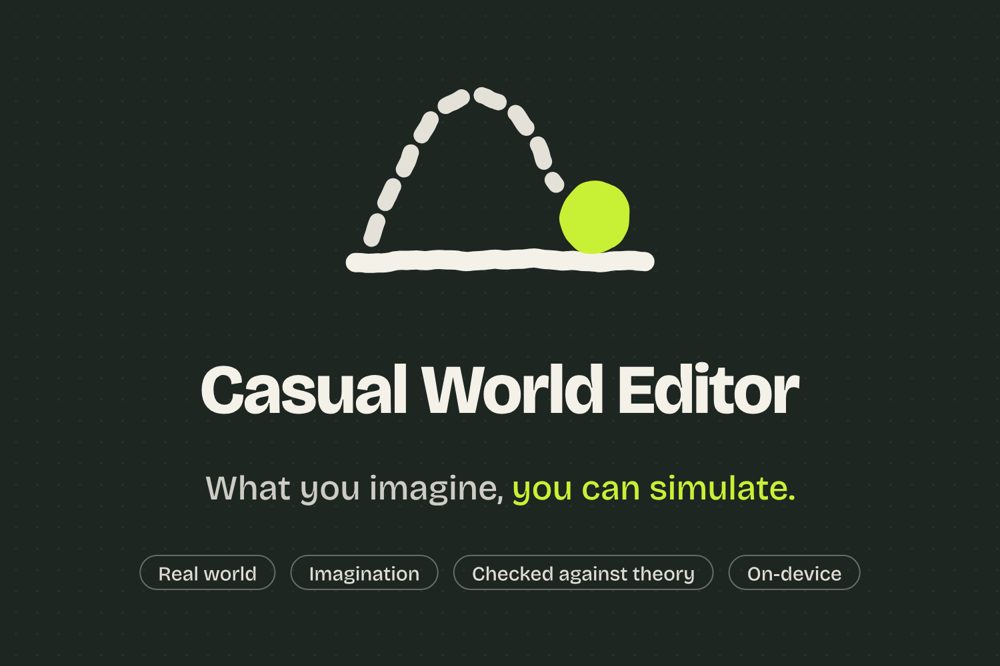

<p align="center"></p>

# Casual World Editor · logo kit

The mark is a throw: a dashed arc and a ball landing on the ground. It is the smallest possible simulation, the
moment an imagined motion becomes a real one. Everything here is vector; the wordmark is outlined, so the SVGs look the
same everywhere without any font installed.

## Pick a file

| Need | Use |
|---|---|
| **Devpost thumbnail** (3:2) | [`png/devpost-thumbnail.png`](png/devpost-thumbnail.png) (1500 × 1000) |
| Devpost / slide cover (16:9) | [`png/cover-16x9.png`](png/cover-16x9.png) (1920 × 1080) |
| App icon, avatar, profile picture | [`png/cwe-icon-1024.png`](png/cwe-icon-1024.png) · [`svg/cwe-icon.svg`](svg/cwe-icon.svg) |
| Logo on a light background | [`svg/cwe-logo-horizontal.svg`](svg/cwe-logo-horizontal.svg) · [`png`](png/cwe-logo-horizontal.png) |
| Logo on a dark background | [`svg/cwe-logo-horizontal-on-dark.svg`](svg/cwe-logo-horizontal-on-dark.svg) · [`png`](png/cwe-logo-horizontal-on-dark.png) |
| Square-ish spaces (posters, slides) | [`svg/cwe-logo-stacked.svg`](svg/cwe-logo-stacked.svg) · [`on dark`](svg/cwe-logo-stacked-on-dark.svg) |
| Just the mark, no background | [`svg/cwe-mark.svg`](svg/cwe-mark.svg) (light bg) · [`svg/cwe-mark-on-dark.svg`](svg/cwe-mark-on-dark.svg) (dark bg) |
| One colour (print, stamps, embossing) | [`svg/cwe-mark-mono-ink.svg`](svg/cwe-mark-mono-ink.svg) · [`svg/cwe-mark-mono-white.svg`](svg/cwe-mark-mono-white.svg) |
| Wordmark alone | [`svg/cwe-wordmark.svg`](svg/cwe-wordmark.svg) · [`on dark`](svg/cwe-wordmark-on-dark.svg) |
| Website favicon | [`favicon.ico`](favicon.ico) · [`png/cwe-icon-32.png`](png/cwe-icon-32.png) · [`png/cwe-icon-180.png`](png/cwe-icon-180.png) (Apple touch) |

<table>
<tr>
<td align="center" bgcolor="#F4F1E8"><br><sub>cwe-icon</sub></td>
<td align="center" bgcolor="#1E2622"><br><sub>cwe-icon-light</sub></td>
<td align="center" bgcolor="#F4F1E8"><br><sub>cwe-icon-lime</sub></td>
<td align="center" bgcolor="#F4F1E8"><br><sub>cwe-mark</sub></td>
</tr>
</table>

<p align="center"></p>

## Colours

| | Name | Hex | Used for |
|---|---|---|---|
|  | **Ink** | `#1E2622` | text, outlines, the icon tile |
|  | **Paper** | `#F4F1E8` | backgrounds, the mark on dark |
|  | **Lime** | `#C8F135` | the ball, highlights, primary buttons |

Lime is the one accent: use it for the thing that moves or the thing to press, never for body text.

## Type

- **Bricolage Grotesque** ExtraBold for the wordmark and headlines (tight tracking, −2 %)
- **Instrument Sans** for body text · **IBM Plex Mono** for numbers and labels

All three are free on Google Fonts (SIL Open Font License).

## Please

- Keep clear space around the logo of at least the ball's diameter.
- Don't recolour, stretch, rotate, outline or add effects to the mark; pick the variant made for your background.
- Keep the icon tile's rounded corners (radius ≈ 23 % of its width).
- Smallest sizes: icon 16 px, horizontal logo 120 px wide.

## Rebuilding

The master is [`../docs/brand/cwe-icon-master.svg`](../docs/brand/cwe-icon-master.svg). To regenerate every file here:

```bash
.venv/bin/python docs/brand/build_logo.py path/to/BricolageGrotesque[opsz,wdth,wght].ttf
```
